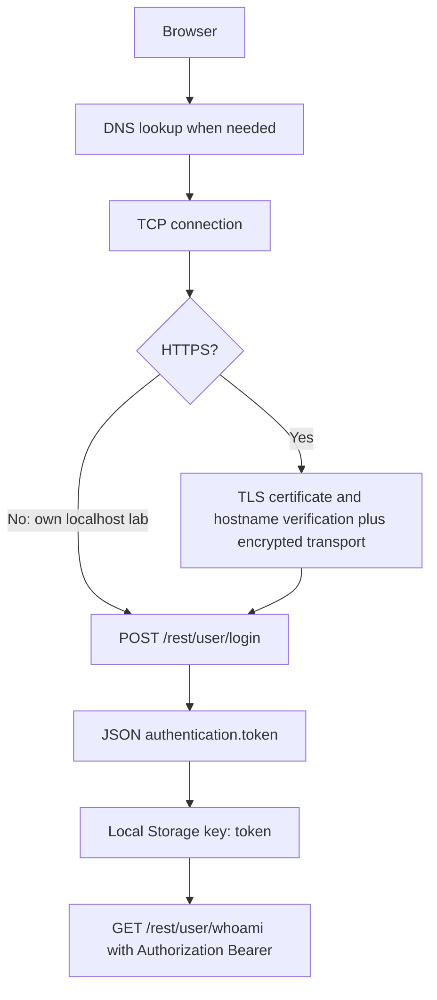

# How systems talk

**Asad Ali Hassan** — Stage 1 networking and web-authentication learning portfolio.

I completed all six lab checkpoints using Ubuntu WSL2 on Windows, Docker Desktop, my own OWASP Juice Shop, Windows Wireshark and Burp Suite Community. All lab checkpoints are passed. The packet-summary exercise is implemented and tested. These files are published on a feature branch with an open pull request. That pull request is not merged, and this publication does not update `main`. Final portfolio sign-off remains outstanding. This publication does not mark a broader roadmap as complete.

## What I captured and learned

| Lab | Notes | Evidence |
|---|---|---|
| 1 · Network interfaces, routes, DNS and listeners | [Network](notes/01-network.md) | Command excerpts in notes |
| 2 · DNS question/answer and iterative lookup | [DNS](notes/02-dns.md) | [Screenshot](captures/dns-wireshark.png), [PCAP](captures/dns.pcap) |
| 3 · TCP setup, HTTP and teardown | [TCP](notes/03-tcp.md) | [Handshake](captures/tcp-handshake.png), [Teardown](captures/tcp-teardown.png), [PCAP](captures/tcp.pcap) |
| 4 · TLS authentication and controlled decryption | [TLS](notes/04-tls.md) | [Encrypted](captures/tls-encrypted.png), [Decrypted view](captures/tls-decrypted.png), [PCAP](captures/tls.pcap) |
| 5 · Login response, storage and bearer request | [Login](notes/05-login-flow.md) | [Burp walkthrough](burp/login-flow.md) |
| 6 · Cookie attributes versus Local Storage | [Cookies](notes/06-cookies-and-sessions.md) | [Cookie settings](captures/cookies-language.png), [Login headers](captures/login-response-headers-redacted.png) |

## Connection and login diagram



The localhost login flow did not use TLS; my separate example.com test did. Localhost resolution need not involve an external DNS lookup. TLS authenticates and protects the connection, not the honesty of website content. Local Storage is accessible to same-origin scripts; HttpOnly applies only to the cookie carrying it.

## Layout

- `notes/`: one Markdown file per lab, including my checkpoint answers.
- `captures/`: original evidence plus clearly named opaque-redacted publication copies.
- [burp/login-flow.md](burp/login-flow.md): detailed observed authentication walkthrough.
- [scripts/pcap_summary.py](scripts/pcap_summary.py): offline educational metadata summary.
- [requirements.txt](requirements.txt): Scapy dependency; [.gitignore](.gitignore): future publication safeguards.

## Run the packet-summary exercise in Ubuntu WSL

These setup commands are instructions only: no packages were installed on my Windows/WSL machine during the review. Testing used an isolated environment on the assistant's box.

```bash
python3 -m venv .venv
source .venv/bin/activate
python -m pip install -r requirements.txt
python scripts/pcap_summary.py captures/dns.pcap captures/tcp.pcap captures/tls.pcap
```

The script reads files only: no sniffing, packets sent, TLS keys or elevated privileges required. It lists DNS queries, SYN/SYN-ACK and sequence-checked completing-ACK **candidates**, plus plaintext HTTP/1.x request lines. It does not call every ACK a handshake. It does not reassemble TCP streams or decrypt TLS, so segmented requests and encrypted HTTP are not decoded. Only known lab routes are displayed; other paths, queries, fragments, headers and bodies are suppressed. DNS names and IP endpoints remain potentially private metadata.

Tested 7 November 2026 (Europe/London): `dns.pcap` had 2 packets and 1 DNS query; `tcp.pcap` had 35 packets, 1 observed handshake candidate and 1 plaintext GET; `tls.pcap` had 23 packets, 1 observed handshake candidate and 0 decoded HTTP requests. The TCP capture also contains an earlier partial connection/keepalives, not just the curl exchange.

During publication of this branch, `scripts/pcap_summary.py` was checked with `python3 -m py_compile` and run again under Scapy 2.8.0 against the three included captures, in an isolated environment. The safe totals matched the results above. That rerun did not decrypt TLS.

## Evidence and redaction review

Four publication copies use opaque black boxes for credential/token value regions. All ten original PNG screenshots and the four new copies were visually inspected. The three PCAP files and six notes were scanned for common credential, Authorization/Cookie, JWT and TLS-key-log indicators; none were found. This is a bounded review, not proof of absence of every possible secret. Encrypted TLS content was not decrypted during this review.

Original screenshots are preserved, but `.gitignore` excludes the four authentication originals in favour of `-redacted.png` copies. The Labs 1–2 GIF was sampled rather than reviewed frame-by-frame, so it is excluded pending full review. Network addresses, MAC addresses and public certificates are not treated as credentials, though they can disclose environment metadata.

Keep key logs, resumption/session secrets, backups and private keys out of publication. `.gitignore` is a safeguard, not access control and not a substitute for checking files before sharing. This snapshot is committed on a feature branch and proposed in a pull request. The pull request is not merged, and this publication does not update `main`.

The lab notes keep my original first-person explanations and checkpoint answers, including the wording I wrote before this branch existed. This README is the snapshot status for the published branch.
