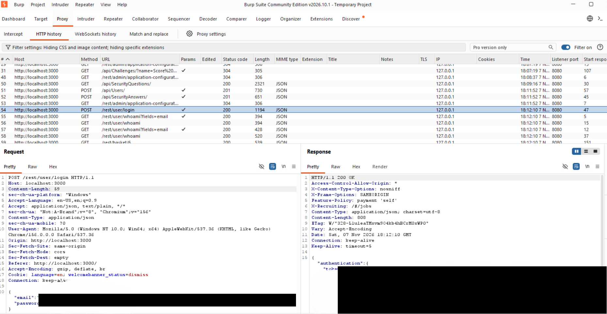
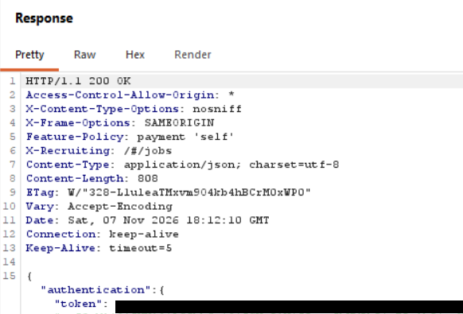
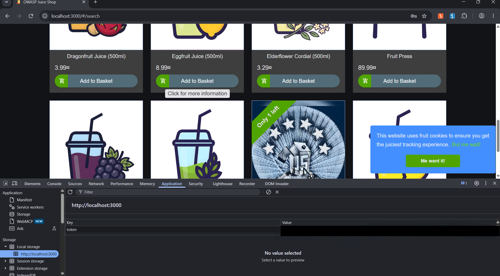
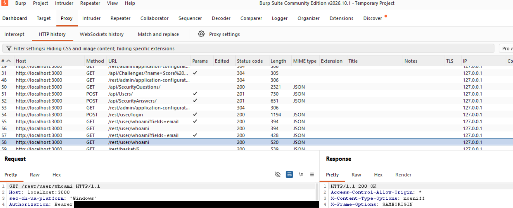

# My observed Burp login flow

**Asad Ali Hassan · local OWASP Juice Shop · 7 November 2026 (Europe/London)**

I used Burp Suite Community on Windows with a temporary project, defaults, interception off and Burp's built-in browser. The target was my own `http://localhost:3000` lab, using a lab-only account. I inspected the existing requests; this walkthrough invents no additional endpoints.

## 1. Login request

I found `POST /rest/user/login` in Proxy → HTTP history. Its request Content-Type was `application/json`; the body field names were `email` and `password`. Credential values are deliberately omitted here. The visible Host was `localhost:3000`.

## 2. Login response

The response was `HTTP/1.1 200 OK`, with JSON containing an `authentication` object and its `token` field. The token value is not reproduced. In Lab 6 I inspected the response headers and found no `Set-Cookie` in that login response. This does not mean the application never uses cookies elsewhere.

## 3. Storage

I opened Developer Tools → Application → Local Storage → `http://localhost:3000` and found the key `token`. The value is hidden in the publication copy.

## 4. Later authenticated request

I selected `GET /rest/user/whoami`. It had `Authorization: Bearer …`; the response status shown was 200. The bearer value is omitted. The browser sends this token instead of resending the password on that request. The evidence establishes this flow, not a universal claim about all requests in Juice Shop.

## Interpretation

My lab used plain HTTP, so Burp could read it directly. Production credentials and bearer tokens need HTTPS in transit. TLS protects transport, not token storage from malicious JavaScript executing on the application's origin.

Local Storage is readable by same-origin JavaScript; successful XSS could expose this token. Cookie flags do not apply to Local Storage. The `language` preference cookie in Lab 6 is separate from this authentication token; missing cookie flags alone did not demonstrate an account-security flaw.

## Related notes and scope

- [Lab 5 notes and my exact checkpoint answer](../notes/05-login-flow.md)
- [Lab 6 cookies and sessions](../notes/06-cookies-and-sessions.md)

The screenshots have opaque value-region redactions. Originals remain local and ignored for future Git use. No original capture was deleted or moved. I have not demonstrated token expiry, revocation, server-side validation details or an exploitable XSS in this exercise.
