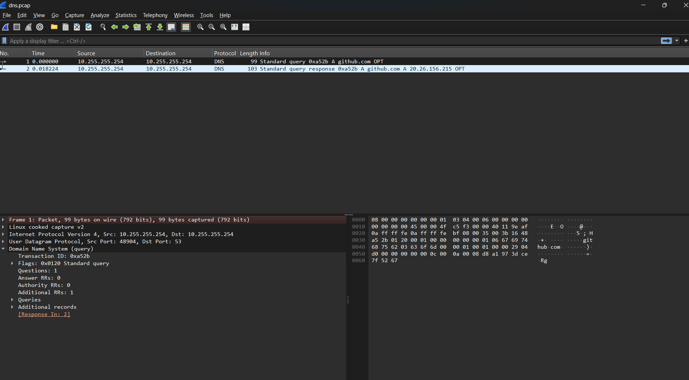

# Lab 2: DNS – resolving github.com

## `dig github.com` – a normal lookup

```text
;; ->>HEADER<<- opcode: QUERY, status: NOERROR, id: 16611
;; flags: qr rd ra; QUERY: 1, ANSWER: 1, AUTHORITY: 0, ADDITIONAL: 1

;; QUESTION SECTION:
;github.com.            IN  A

;; ANSWER SECTION:
github.com.      30     IN  A   20.26.156.215

;; Query time: 24 msec
;; SERVER: 10.255.255.254#53(10.255.255.254) (UDP)
;; WHEN: Thu Oct 29 19:16:20 GMT 2026
```

### Interpreting the normal lookup

- **status: NOERROR** means the lookup worked. **id: 16611** is the transaction ID that pairs this answer with my question.
- **Flags:** `qr` means this is a response, `rd` means I asked for recursion, and `ra` means recursion is available, not proof that this particular answer required recursion.
- **Answer:** the A record (IPv4) for github.com is `20.26.156.215`, with a TTL of 30 seconds. Short TTLs permit quicker DNS changes; this output does not establish why this TTL was chosen.
- **Server:** `10.255.255.254#53 (UDP)` is the WSL DNS proxy from Lab 1.
- **Query time:** 24 ms. A cached repeat lookup may be faster, and its remaining TTL can count down.

## `dig +trace github.com` – the full path from the root

```text
.        419290  IN  NS  f.root-servers.net.
;; Received 783 bytes from 10.255.255.254#53 in 43 ms

;; UDP setup with 2001:7fd::1#53 for github.com failed: network unreachable.
;; (more IPv6 failures trimmed)

com.     172800  IN  NS  a.gtld-servers.net.   (a to m)
com.     86400   IN  DS  19718 13 2 ...        (DNSSEC, trimmed)
;; Received 1198 bytes from 192.112.36.4#53(g.root-servers.net) in 43 ms

github.com.  172800  IN  NS  ns-1707.awsdns-21.co.uk.
github.com.  172800  IN  NS  dns1.p08.nsone.net.   (+ 3 more awsdns, 3 more nsone)
;; (NSEC3 / RRSIG records trimmed)
;; Received 663 bytes from 192.43.172.30#53(i.gtld-servers.net) in 35 ms

github.com.  60  IN  A  20.26.156.215
;; Received 278 bytes from 205.251.198.171#53(ns-1707.awsdns-21.co.uk) in 23 ms
```

### Interpreting the trace

1. **Root:** my proxy gave dig the list of root servers (a to m.root-servers.net), the top of DNS.
2. **IPv6 errors are expected:** dig tried root servers over IPv6, but this WSL environment had no usable route to those external IPv6 addresses; local IPv6 still works, so it fell back to IPv4 by itself.
3. **.com referral:** `g.root-servers.net` didn't know github.com, so it pointed me to the .com servers (a to m.gtld-servers.net).
4. **GitHub's name servers:** `i.gtld-servers.net` pointed me to GitHub's name servers on AWS Route 53 (`awsdns`) and NS1 (`nsone`). Multiple DNS providers can improve resilience, but these records alone do not guarantee availability.
5. **Authoritative answer:** `ns-1707.awsdns-21.co.uk` returned `20.26.156.215` with a TTL of **60**. The earlier 30 is consistent with a cached answer whose TTL had counted down.
6. **DNSSEC:** DS records link delegations, RRSIG records carry signatures, and NSEC3 supports authenticated denial of existence. Seeing them in `dig +trace` does not prove validation succeeded or that the final github.com A answer was signed.

## Wireshark capture

Captured with `sudo tcpdump -i any -w dns.pcap port 53`, then opened in Wireshark on Windows.

> Lesson: `-i eth0` captured nothing because DNS goes to the WSL proxy on loopback. I had to use `-i any` (or `-i lo`).



- **Packet 1 (query):** from source port 48904 (random) to UDP port 53, Transaction ID `0xa52b`, 1 question (A github.com), 0 answers.
- **Packet 2 (response):** same ID `0xa52b`, answer `20.26.156.215`, 18 ms later. Wireshark links the pair with `[Response In: 2]`.
- Source and destination are both `10.255.255.254`, so the whole exchange stayed on loopback inside WSL.

## Security takeaway

This capture uses plaintext DNS over UDP (DNS can also use TCP). On-path observers can see query names, which do not necessarily prove a website visit. Forged responses must satisfy resolver checks; source-port and transaction-ID guessing alone is not a universal guarantee. Proper DNSSEC validation authenticates signed DNS data; DoH encrypts the client-to-resolver leg, not queries from the resolver onward, and the resolver still sees the names.
