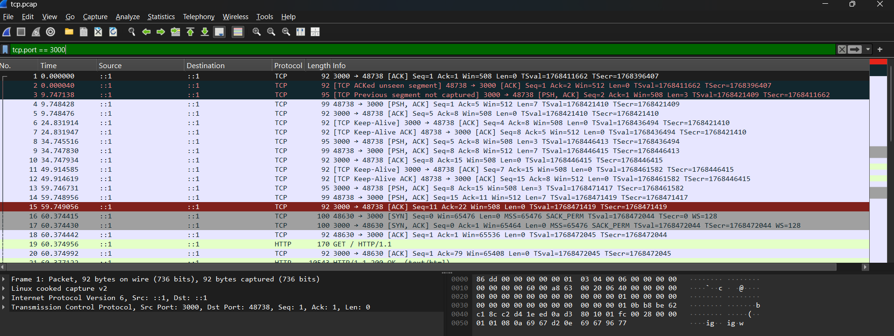
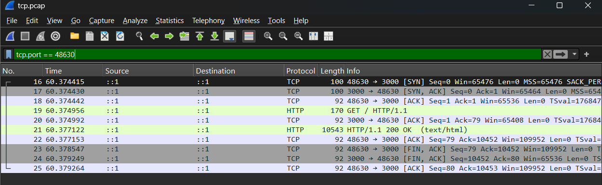

# Lab 3 – TCP Handshake and Teardown Analysis

## 1. TCP Three-Way Handshake (Packets 16–18)

| Packet | TCP Flag | Explanation |
|---|---|---|
| 16 | SYN | My curl client initiated a TCP connection from source port 48630 to the Juice Shop server on port 3000. The initial sequence number was 0. |
| 17 | SYN, ACK | The Juice Shop server responded, acknowledging my SYN with Ack=1 and sending its own SYN to establish the connection. |
| 18 | ACK | My curl client acknowledged the server's SYN. The three-way handshake was complete, and the TCP connection was established. |

> Note: Wireshark shows relative sequence numbers, so Seq=0 is not the real value. The real initial sequence number is random, which makes it hard for an attacker to guess and inject packets into the connection.

## 2. HTTP Request and Response (Packets 19–21)

| Packet | Protocol / Flag | Explanation |
|---|---|---|
| 19 | HTTP GET | My curl client sent an HTTP GET / HTTP/1.1 request to retrieve the Juice Shop homepage. |
| 20 | TCP ACK | The server acknowledged receiving the HTTP request data. |
| 21 | HTTP 200 OK | The Juice Shop server successfully processed the request and returned HTTP/1.1 200 OK, including the HTML content of the homepage. |

## 3. TCP Connection Teardown (Packets 22–25)

| Packet | TCP Flag | Explanation |
|---|---|---|
| 22 | ACK | My curl client acknowledged receiving the server's response, confirming receipt of all 10,451 bytes of TCP response payload (including HTTP headers and body, not just HTML) (Ack=10452). |
| 23 | FIN, ACK | My curl client initiated the connection termination by sending a FIN flag, indicating that it had finished transmitting data. |
| 24 | FIN, ACK | The Juice Shop server acknowledged the client's FIN (Ack=80) and sent its own FIN to indicate that it had also finished transmitting. |
| 25 | ACK | My curl client acknowledged the server's FIN (Ack=10453). The TCP connection was successfully terminated. |

## 4. Why did I see ::1 instead of 127.0.0.1?

I saw ::1 because localhost resolved to the IPv6 loopback address rather than the IPv4 loopback address (127.0.0.1). Both addresses refer to the local machine, but ::1 is the IPv6 equivalent of 127.0.0.1. Since curl connected through IPv6 inside WSL, Wireshark captured the communication using ::1. This does not require an external IPv6 internet connection because loopback traffic stays within the local system.

## 5. Conclusion

The packet capture demonstrates the complete TCP communication lifecycle:

1. Connection establishment: TCP three-way handshake (SYN, SYN-ACK, ACK).
2. Data exchange: HTTP GET request and HTTP 200 OK response.
3. Connection termination: TCP FIN and ACK exchange.

The complete communication occurred over the IPv6 loopback interface (::1) between my curl client and the Juice Shop application on port 3000. The connection was established and terminated successfully in approximately 5 milliseconds.
