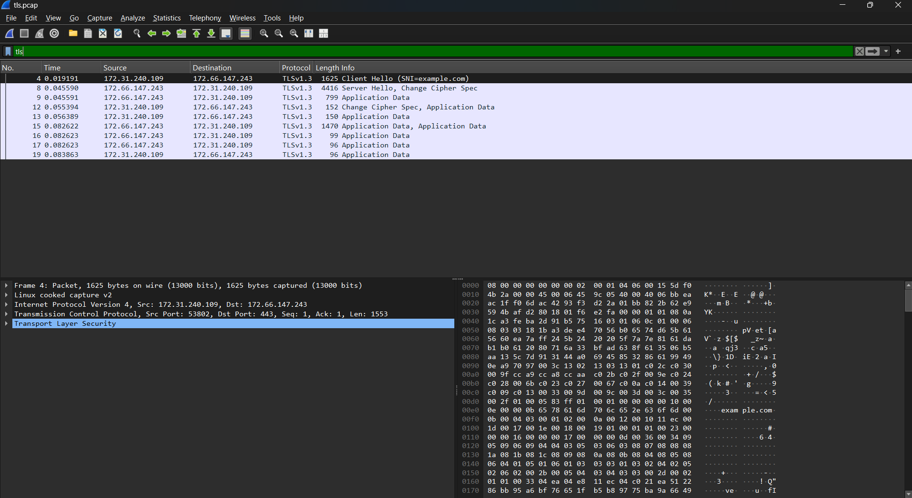
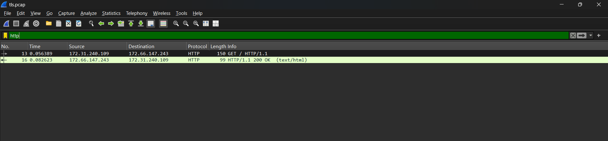

# Lab 4 – TLS Certificate Verification and Encryption

## Command

```bash
openssl s_client -connect example.com:443 -servername example.com -verify_hostname example.com -verify_return_error </dev/null
```

- `-connect example.com:443` connects to the server on its HTTPS port.
- `-servername example.com` sends the hostname using Server Name Indication (SNI), so the server can select the appropriate certificate.
- `-verify_hostname example.com` checks that the certificate matches the intended hostname.
- `-verify_return_error` stops the handshake if certificate verification fails.
- `</dev/null` ends the input instead of leaving OpenSSL waiting for me to type.

## Verification Results

Selected lines from my output, with session secrets omitted:

```text
Connecting to 172.66.147.243
CONNECTED(00000003)

subject=CN=example.com
issuer=C=US, O=SSL Corporation, CN=Cloudflare TLS Issuing ECC CA 3

Peer signing digest: SHA256
Peer signature type: ecdsa_secp256r1_sha256
Negotiated TLS1.3 group: X25519MLKEM768

Verification: OK
Verified peername: example.com

New, TLSv1.3, Cipher is TLS_AES_256_GCM_SHA384
Protocol: TLSv1.3
Verify return code: 0 (ok)

DONE
```

## 1. Certificate Verification

Verifying the certificate chain and hostname tells me that I am connecting to a server that has presented a valid certificate for the domain I intended to visit.

- **Certificate chain verification:** Confirms that the server's certificate was issued through a chain leading to a trusted Certificate Authority (CA).
- **Hostname verification:** Confirms that the certificate is valid for the domain I'm connecting to, such as example.com.
- **Proof of private-key possession:** During the handshake, the server also proves that it holds the private key associated with its certificate. Simply presenting a public certificate is not enough to authenticate it.
- **Server authentication:** Helps protect against Man-in-the-Middle (MITM) attacks by making it harder for an attacker to impersonate the legitimate server.

In my OpenSSL test, `Verified peername: example.com` confirmed that the certificate matched the requested hostname, while `Verify return code: 0 (ok)` confirmed that certificate validation succeeded.

### Certificate Chain

OpenSSL's verification output showed this chain, from the server certificate to the trusted root:

1. `example.com`
2. `Cloudflare TLS Issuing ECC CA 3`
3. `SSL.com TLS Transit ECC CA R2`
4. `SSL.com TLS ECC Root CA 2022`

The server also supplied a cross-signed version of the SSL.com root certificate issued by `AAA Certificate Services`. OpenSSL's verification output stopped at the trusted SSL.com root.

## 2. TLS Encryption

TLS encryption protects data transmitted between my client and the server from being read or modified without detection by unauthorized third parties.

TLS provides three important security properties:

1. **Confidentiality:** Encrypts transmitted data, protecting sensitive information such as passwords, session cookies, and personal information from network eavesdroppers.
2. **Integrity:** Detects unauthorized modification of data during transmission.
3. **Authentication:** Uses certificates and cryptographic verification to help confirm the identity of the server.

### Negotiated Algorithms

- **Protocol:** `TLSv1.3`.
- **Cipher suite:** `TLS_AES_256_GCM_SHA384`. AES-256-GCM encrypts the traffic and detects modification; SHA-384 is used in TLS key derivation.
- **Key exchange group:** `X25519MLKEM768`, which combines X25519 with the post-quantum ML-KEM-768 algorithm to establish shared secrets.
- **Handshake signature:** `ecdsa_secp256r1_sha256`, used to authenticate the server's handshake. This is separate from the cipher suite and key exchange.

## 3. Does a Valid TLS Certificate Mean a Website Is Safe?

No. A valid TLS certificate does not automatically mean a website is safe or trustworthy.

A malicious website can obtain a legitimate TLS certificate and use HTTPS to encrypt communications.

For example, a phishing website might have a valid certificate but still attempt to steal passwords or financial information.

TLS protects the security of communication between the client and server, but it does not guarantee that the website itself is legitimate, free from vulnerabilities, or safe to use.

## 4. Conclusion

In my lab, the successful TLS 1.3 handshake, certificate validation, and hostname verification demonstrated that the connection to example.com was authenticated and encrypted using `TLS_AES_256_GCM_SHA384`.

I have omitted the resumption PSK values and session-ticket dumps because they contain sensitive session material. The server certificate is public information.

## 5. Completed practical: capture and decryption

I captured my own controlled HTTPS request to example.com, using tcpdump in WSL and OpenSSL with a private `-keylogfile`. In Windows Wireshark I first observed encrypted TLS records, then configured the private key-log filename in TLS preferences. The decrypted view showed `GET / HTTP/1.1` (packet 13) and `HTTP/1.1 200 OK` (packet 16).





### My checkpoint answer

> Wireshark can read the HTTPS connection now because I supplied it with the TLS session keys needed to decrypt the captured traffic.

I did not break TLS: the capture alone lacks those session secrets. I must keep the key log private and out of any portfolio publication. The packet-summary script intentionally does not load keys or decrypt TLS.
